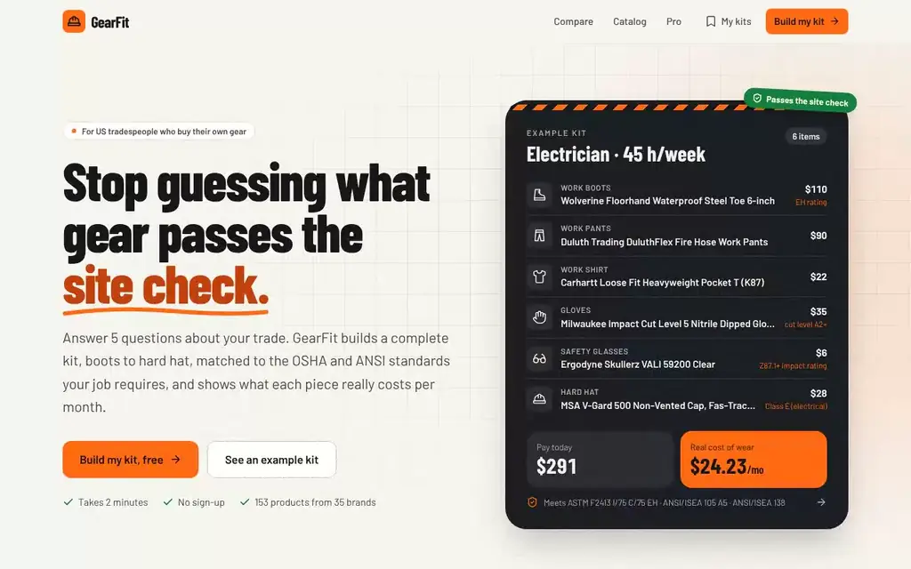
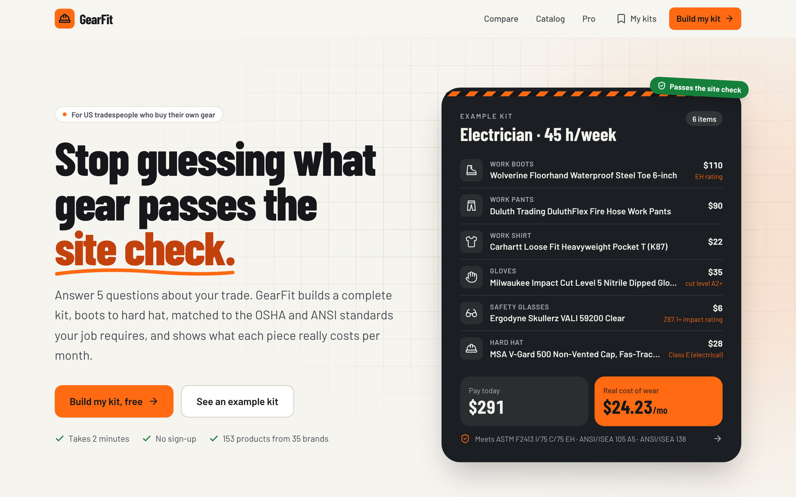
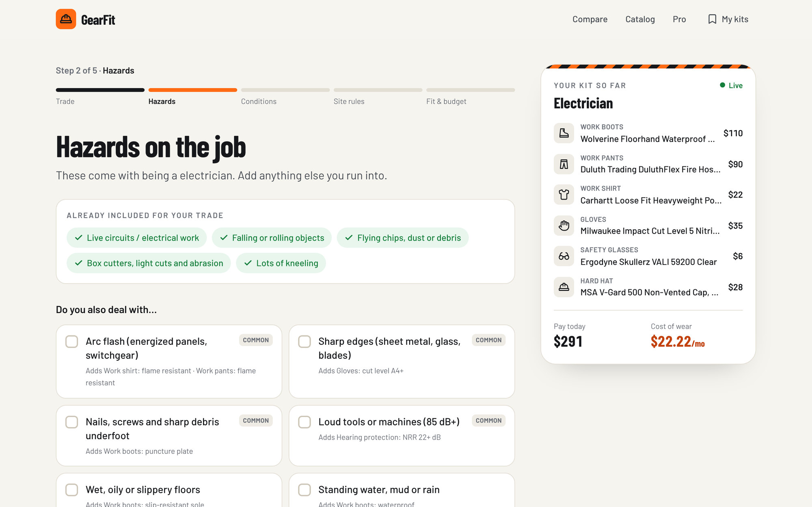
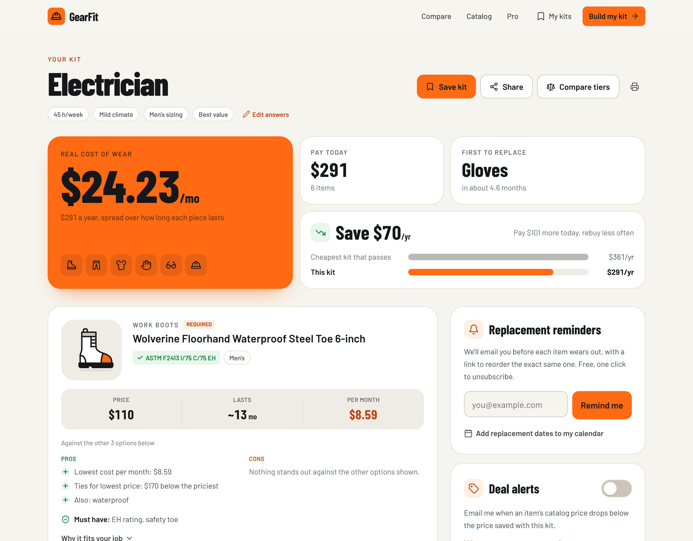
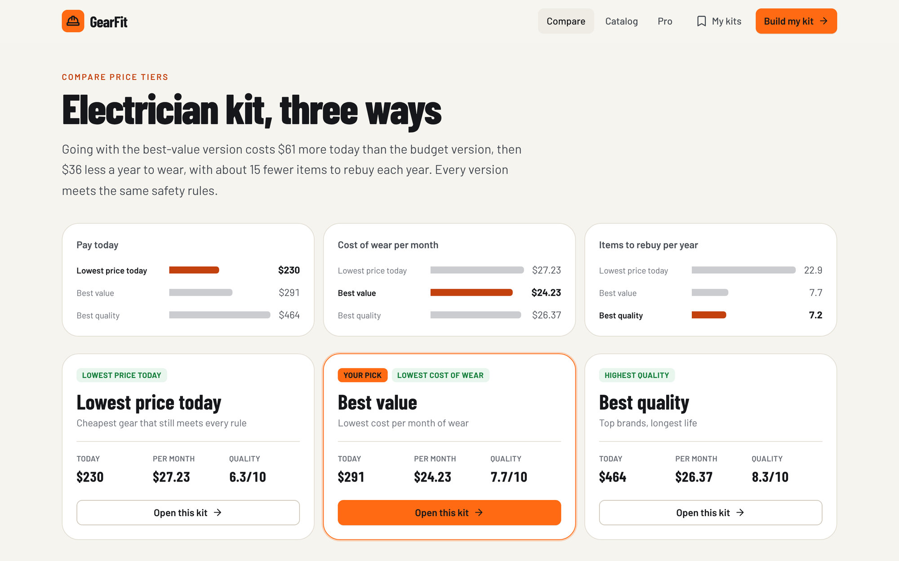
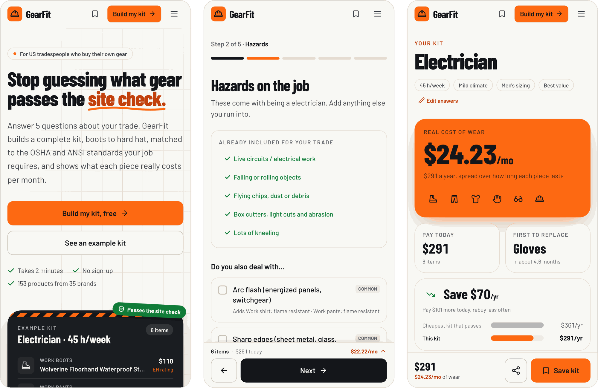
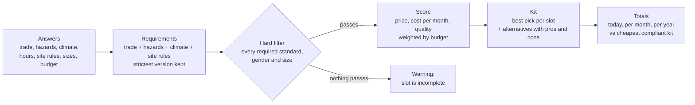
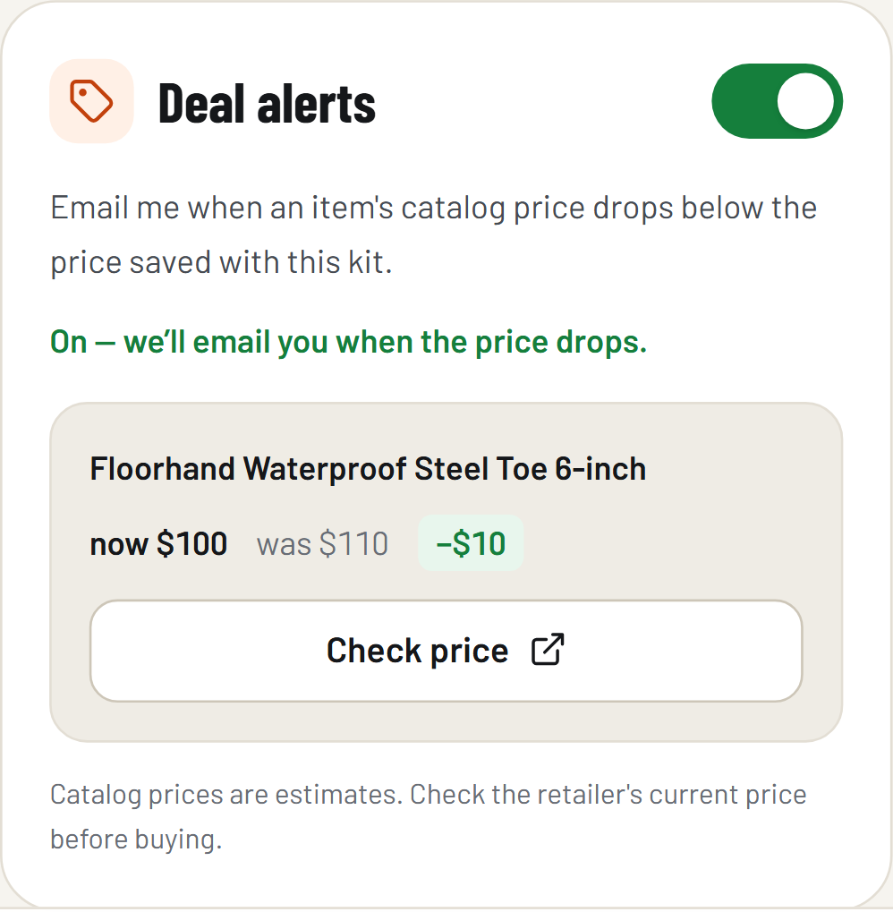
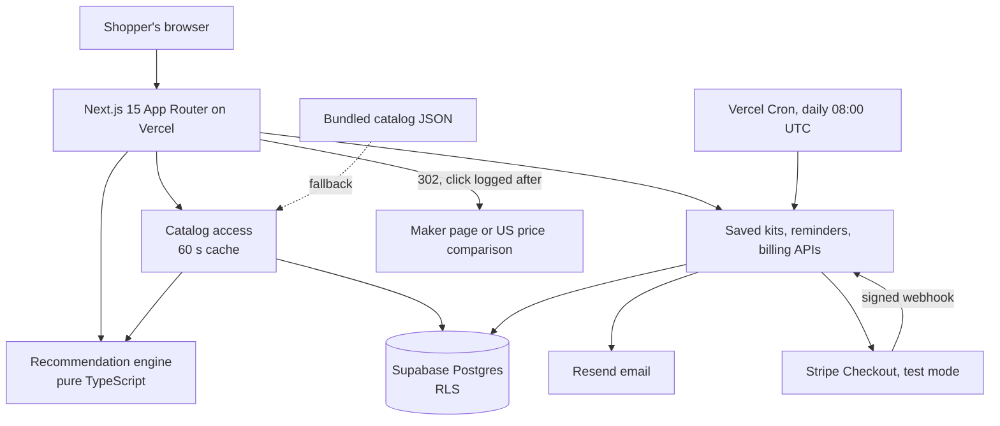

<div align="center">


# GearFit

**Stop guessing what gear passes the site check.**

Answer 5 questions about your trade. GearFit builds a complete work kit, boots to hard hat,<br>
matched to the safety standards your job requires, and shows what each piece really costs per month of wear.

[](https://palantirbuisness.vercel.app)
[](https://github.com/baurvtm-stack/BUISNESSCUP_PALANTIR/actions/workflows/ci.yml)
[](https://nextjs.org)
[](tsconfig.json)
[](https://tailwindcss.com)
[](supabase/migrations)
[](src/app/api/subscribe/route.ts)
[](#team)

**[Try it live](https://palantirbuisness.vercel.app)** · [Demo in 60 seconds](#try-it-in-60-seconds) · [How it works](#how-the-recommendation-works) · [Business model](#business-model) · [Architecture](#architecture) · [Run locally](#run-locally)

<br>



<sub>Recorded on a production build of <code>main</code>: an electrician adds "loud tools", gets a 7-piece kit, then swaps boots for a pair with the same price tag and a higher cost of wear.</sub>

</div>

<br>

> **No sign-up, no app to install: the kit lives in the link.** 153 real products from 35 brands in 9 categories, 11 trades, women's sizing included.

## The problem

US tradespeople pay for a lot of their own gear. OSHA makes employers pay for most PPE, but not for non-specialty safety-toe boots, everyday work clothing or weather gear ([29 CFR 1910.132(h)](https://www.osha.gov/laws-regs/regulations/standardnumber/1910/1910.132)). Self-employed contractors buy everything. So an electrician, roofer or welder buys the boots, pants, gloves and glasses the site demands, out of pocket, again and again.

Three things make that harder than it should be:

1. **Site rules are written in codes.** The site says "EH-rated safety toe, Z87+ glasses, Class 2 hi-vis". The product pages say ASTM F2413, ANSI Z87.1, ANSI/ISEA 107. Matching the two across a whole kit is homework, and a mismatch can mean buying twice.
2. **The price tag hides the real cost.** Work gear is a consumable. Two safety-toe boots in our catalog both cost **$110**. At 45 hours a week one lasts about 8 months and the other about 13 (GearFit estimates from catalog lifespan data). That is **$13.25 vs $8.59 a month: 54% more for the same sticker price.**
3. **Nobody tracks replacement.** Gear wears out on a schedule nobody writes down, so replacement usually happens after the glove tears or the sole splits.

## Who it is for

US tradespeople aged **25–45 who buy their own boots and PPE**: apprentices and journeymen, independent contractors, and anyone whose employer covers only part of the kit.

Supported today: electrician, carpenter/framer, construction laborer, plumber/pipefitter, HVAC technician, welder/fabricator, roofer, warehouse/forklift, auto/diesel mechanic, landscaper, road crew/flagger. Women's sizing is built in: 25 women's models, plus 85 unisex ones.

## What GearFit does

| | |
| --- | --- |
| **Standards-matched kit** | Trade, hazards, climate, hours and site rules become a list of requirements (ASTM F2413, ANSI Z87.1, ANSI Z89.1, ANSI/ISEA 105, 107 and 138, NFPA 70E). Only gear that meets every one of them is shown, and each pick says *why* it is there. |
| **Real cost of wear** | Every item shows today's price, estimated months of use at *your* hours, and cost per month. The kit compares itself with the cheapest compliant kit, for example: pay $101 more today, save $70 a year. |
| **Swap and compare** | Each slot offers alternatives (lowest price, lowest cost per month, top quality) with pros and cons computed from catalog data. Compare shows your kit three ways (*Lowest price today*, *Best value*, *Best quality*) side by side. |
| **No account, one link** | The whole kit is encoded in its URL. Save it to My kits, share it with the phone's share sheet, print a shopping list, or get a short `/k/<slug>` link that rebuilds the same kit on any device. |
| **Check price** | Opens the maker's own product page (152 of 153 products), logged as a click tied to the kit. Visitors outside the US get a US Google Shopping comparison for the same model, because many US stores block them. |
| **Replacement reminders** | Add every replacement date to your calendar (an `.ics` file with an alert a week before each), or opt in to email reminders with double opt-in and one-click unsubscribe. |
| **GearFit Pro, $4/month** | Wear tracker for every item, deal alerts when a saved item's catalog price drops, price drops on My kits, and unlimited saved kits. |

<table>
  <tr>
    <td width="50%" valign="top"><br><sub><b>Landing.</b> One promise, the standards it checks, and a 2-minute start.</sub></td>
    <td width="50%" valign="top"><br><sub><b>5 questions.</b> Trade, hazards, conditions, site rules, fit and budget, with the kit building live on the right.</sub></td>
  </tr>
  <tr>
    <td width="50%" valign="top"><br><sub><b>The kit.</b> Every piece with its standard, price, months of wear and cost per month, plus swap options.</sub></td>
    <td width="50%" valign="top"><br><sub><b>Compare.</b> The same kit at three budget levels, item by item.</sub></td>
  </tr>
</table>

<p align="center">
  <br>
  <sub>Built for the phone in a work truck: landing, questionnaire and kit on mobile.</sub>
</p>

## Try it in 60 seconds

Everything below runs on production, with no sign-up.

1. **Open a ready kit:** [electrician, 45 hours a week](https://palantirbuisness.vercel.app/kit?k=eyJ0cmFkZSI6ImVsZWN0cmljaWFuIiwiZ2VuZGVyIjoibWVuIiwiaG91cnNQZXJXZWVrIjo0NX0). Six pieces, **$291 today, $24.23 a month**, $101 more than the cheapest compliant kit today but **$70 a year cheaper** to keep up. Gloves are the first thing to replace, in about 4.6 months.
2. **Swap the boots** for the other $110 pair under *Lowest price*. Same sticker price, and the monthly cost rises to $28.89, because that pair wears out sooner.
3. **[Compare price tiers](https://palantirbuisness.vercel.app/compare?k=eyJ0cmFkZSI6ImVsZWN0cmljaWFuIiwiZ2VuZGVyIjoibWVuIiwiaG91cnNQZXJXZWVrIjo0NX0):** the same kit at *Lowest price today*, *Best value* and *Best quality*.
4. **Save, then Share.** You get a short `/k/<slug>` link. Open it in a private window: the server rebuilds the identical kit.
5. **Check price** on any item to land on the maker's product page.
6. **Go Pro** on [/pro](https://palantirbuisness.vercel.app/pro) with the Stripe test card `4242 4242 4242 4242`, any future date and any CVC. Pro switches on, and My kits shows the wear tracker.

Or [build your own kit](https://palantirbuisness.vercel.app/build) from scratch.

> [!NOTE]
> Email is sent through Resend's onboarding sender until a sending domain is verified, so live reminder and deal emails reach the team's inbox only. Other visitors are offered the calendar file instead. The team-run deal alert demo is in the [deployment guide](docs/backend-handoff.md#60-second-production-demo).

## How the recommendation works

The engine in [`src/lib/engine.ts`](src/lib/engine.ts) is a pure, deterministic TypeScript function: same answers, same kit. No generated text, no hidden ranking.



- **Safety is a filter, never a trade-off.** A product that misses any required standard or feature is never shown, at any budget. If nothing in a slot qualifies, the kit says so instead of substituting quietly. A "max for the whole kit" cap swaps in cheaper *compliant* picks, and warns when that is impossible.
- **Wear life scales with your hours.** Each product has light, moderate and heavy wear estimates. Up to 20 h/week uses the light estimate, 20–40 h moves toward moderate, 40–60 h toward heavy, and beyond 60 h the heavy estimate shrinks in proportion. Hard hats are capped at the moderate estimate, because they also age with time.
- **Ranking follows the budget you pick.** Scores are normalized across the eligible products in each slot:

  | Budget | Price today | Cost per month | Quality |
  | --- | ---: | ---: | ---: |
  | Lowest price today | 0.60 | 0.25 | 0.15 |
  | Best value | 0.20 | 0.50 | 0.30 |
  | Best quality | 0.05 | 0.25 | 0.70 |

  Each recommended (not mandatory) feature met adds 0.35 and a climate match adds 0.1. Each specialty feature you do not need (welding, chemical, flame-resistant) subtracts 0.3, so nobody overpays for protection their job does not call for. Ties break by price, then product ID.
- **Specialty hazards come with honest warnings.** Chemical, arc-flash and welding work add task-specific gloves and a plain-language note on what the kit cannot cover, such as a welding helmet or the employer's arc-flash assessment.
- **Pros and cons come from data only**: price, wear life, cost per month, quality score, rated levels against the requirement, features and sizing, ranked among the options shown.

## Business model

The free product does the whole job once. Pro is for people who keep buying.

| | Free | Pro, $4/month |
| --- | :---: | :---: |
| Standards-matched kit for your trade | ✓ | ✓ |
| Cost per month and swap options | ✓ | ✓ |
| Compare price tiers side by side | ✓ | ✓ |
| Email and calendar replacement reminders | ✓ | ✓ |
| Saved kits | 3 per device | Unlimited |
| Wear tracker for every item | | ✓ |
| Deal alerts and price drops on your exact gear | | ✓ |

<p align="center">
  <br>
  <sub>Pro deal alerts: a saved item's catalog price dropped, with a tracked link to check it.</sub>
</p>

**Where the money comes from**

- **Pro subscription.** $4 a month through Stripe Checkout, verified on the server and kept in sync by signed webhooks. The pitch is on the Pro page: *a 25% sale on a $200 pair of work boots saves $50; a year of Pro costs $48.* During the hackathon it runs in Stripe test mode, and the server refuses live keys on purpose.
- **Commerce.** Every *Check price* is a logged outbound click tied to the kit that produced it, so we can see which trades and gear slots drive buying intent before signing retailer affiliate programs. The server adds a partner tag to Amazon fallback links when one is configured; maker pages are untagged today.

**Why people come back.** Gear wears out on a schedule, and GearFit knows it. Each replacement date brings the buyer back to a saved kit that already knows their trade, standards and size, one tap from *Check price*. Deal alerts bring them back when a price drops.

**Why acquisition is cheap.** There is no sign-up wall. A kit is a link that opens on any phone, so it can be passed around a crew that works under the same site rules.

**What we measure.** [`GET /api/stats`](https://palantirbuisness.vercel.app/api/stats) counts kits created, Check price clicks, reminder sign-ups and confirmations, Pro conversions and active Pro subscriptions, straight from SQL. We quote no market or traction numbers here that we have not measured.

## Architecture



Key decisions:

- **The kit is the URL.** Answers are a validated, URL-safe token (`/kit?k=…&c=…`), so kits work without accounts. Cloud saves rebuild the kit on the server from the answers and keep only eligible swaps: client prices and safety claims are ignored.
- **The catalog never blocks a shopper.** Supabase is the source of truth. Kit pages and Check price read it through a 60-second cache and fall back to the bundled snapshot when a read fails.
- **Clicks never slow the shopper.** `GET /api/click` answers 302 first and records the click afterwards with Next.js `after()`, so a failed insert cannot break the redirect.
- **Reminders respect consent.** Double opt-in, `List-Unsubscribe` one-click headers, consent rechecked right before each send, and a due date seven days before each item's estimated replacement.
- **Payments are verified on the server.** Checkout status and signed webhooks decide Pro access. The access token stays on the buyer's device and never appears in links or logs.
- **Defensive by default.** Zod on every input, Row Level Security with server-only keys, size limits on every JSON body, and per-IP rate limits that store hashes, never raw IPs.

### Tech stack

| Layer | Choice |
| --- | --- |
| App | Next.js 15 (App Router), React 19, TypeScript (strict) |
| UI | Tailwind CSS 4, in-house SVG gear illustrations, CSS animations plus Motion loaded lazily on two pages, `prefers-reduced-motion` respected |
| Validation | Zod 4 for every API body and URL token |
| Data | Supabase Postgres with RLS and SQL RPCs; bundled JSON snapshot as fallback |
| Email | Resend: double opt-in reminders and deal alerts |
| Payments | Stripe Checkout (test mode) and signed webhooks |
| Hosting | Vercel, with Vercel Cron for the daily reminder run |
| Tests | Vitest and PGlite (real SQL migrations), Playwright on desktop and mobile Chromium |

### Project structure

```text
src/
├── app/                 Pages and API routes (App Router)
│   ├── build/           5-step questionnaire with live kit preview
│   ├── kit/             Kit page: picks, swaps, totals, save, share, reminders
│   ├── compare/         One kit at three budget levels, or saved kits side by side
│   ├── k/[slug]/        Short links for cloud-saved kits
│   ├── kits/            My kits: saved kits, wear tracker and price drops (Pro)
│   ├── pro/             GearFit Pro and Stripe Checkout
│   ├── catalog/         The full product catalog
│   ├── go/[id]/         Check price hand-off: logs the click, then opens the store
│   └── api/             REST endpoints (see the API reference below)
├── components/          UI kit, SVG gear art, deal alerts, reminder form
├── data/                catalog.json (153 products), trades, hazards, site rules
└── lib/
    ├── engine.ts        Recommendation engine: pure and deterministic
    ├── standards.ts     Which standards a kit covers
    ├── pros-cons.ts     Data-only pros and cons
    ├── ics.ts           Calendar export
    ├── server/          Catalog cache and fallback, click logging, server-side kit rebuild
    └── retention/       Saved kits, reminders, billing (Supabase, Resend, Stripe)
supabase/migrations/     Catalog, clicks, kits, reminders, billing, stats
tests/                   Vitest: engine, APIs, SQL migrations and RPCs in PGlite
e2e/                     Playwright judge journey, desktop and mobile
scripts/                 Seed, catalog check, smoke test, e2e runner
docs/                    Deployment guide, API contract, catalog sources, testing
```

## Run locally

Requires **Node.js 24** (see `.nvmrc`; 22.12 at minimum) and npm.

```bash
git clone https://github.com/baurvtm-stack/BUISNESSCUP_PALANTIR.git
cd BUISNESSCUP_PALANTIR
npm ci
cp .env.example .env.local   # PowerShell: Copy-Item .env.example .env.local
npm run dev                  # http://localhost:3000
```

With no credentials, GearFit runs on the bundled catalog: the questionnaire, kits, swaps, compare, saving on the device and the calendar export all work. Short `/k/` links, email, Pro and stats need Supabase, Resend and Stripe test keys. Never prefix server secrets with `NEXT_PUBLIC_`.

<details>
<summary><b>Deploy your own (Supabase, Vercel, Stripe, Resend)</b></summary>

<br>

1. In Supabase SQL Editor, apply `supabase/migrations/202611140001_catalog.sql`, then `202611140002_clicks.sql` once.
2. Set the Supabase URL and server key in `.env.local`. Run `npm run catalog:check`, then `npm run seed`. The seed upserts by product ID without deleting other products or clicks. To update only the Check price links of an already seeded catalog, paste `supabase/manufacturer-links.sql` into SQL Editor instead. It changes `retailer_url` only and is safe to run again.
3. Paste `supabase/retention-setup.sql` and run it **once**. Alternatively apply the four `20261114100001`–`20261114100004` migrations in order; do not apply both methods or replay an existing schema.
4. Import the repo into Vercel, select Node.js 24, configure variables for the intended environments and redeploy. `vercel.json` supplies Next.js build settings and the daily cron.
5. Configure a Stripe **test** webhook at `<APP_URL>/api/stripe/webhook` for `checkout.session.completed`, `customer.subscription.created`, `customer.subscription.updated` and `customer.subscription.deleted`.
6. Configure Resend. Its onboarding sender only delivers to the account owner's inbox; other recipients require a verified sending domain.
7. Run `npm run smoke`, then the [saved-kit, reminder and checkout demo](docs/backend-handoff.md#60-second-production-demo).

The smoke script checks public routes only. Live email delivery, Checkout and webhook processing need the separate demo. See the [deployment guide](docs/backend-handoff.md) for operational details.

</details>

<details>
<summary><b>Environment variables</b></summary>

<br>

Copy the documented defaults from [.env.example](.env.example). Vercel injects the `VERCEL*` values.

| Variable | Purpose / default |
| --- | --- |
| `SUPABASE_URL` | Project API URL; pair with a server key to enable persistence |
| `SUPABASE_SECRET_KEY` | Preferred Supabase server key (`sb_secret_...`) |
| `SUPABASE_SERVICE_ROLE_KEY` | Legacy fallback, used only when the preferred key is blank |
| `AFFILIATE_TAG` | Optional Amazon partner tag, added to Amazon fallback links only; blank leaves links untagged |
| `AFFILIATE_PARAM` | Partner query parameter; defaults to `tag` |
| `APP_URL` | Canonical origin for email/checkout, e.g. `https://palantirbuisness.vercel.app`; local HTTP supported |
| `VERCEL_PROJECT_PRODUCTION_URL` | Injected production hostname; HTTPS fallback when `APP_URL` is blank |
| `RATE_LIMIT_SECRET` | Recommended random 32+ byte HMAC secret; absent → unsalted SHA-256 buckets |
| `CRON_SECRET` | Required independent bearer secret for cron and demo sends |
| `RESEND_API_KEY` | Server email API key |
| `RESEND_FROM` | Verified sender, e.g. `GearFit <reminders@example.com>` |
| `REMINDER_TEST_MODE` | `true` enables authenticated immediate demo sends; default `false` |
| `STRIPE_SECRET_KEY` | Test key (`sk_test_...`); live keys rejected |
| `STRIPE_WEBHOOK_SECRET` | Signing secret (`whsec_...`) for the deployed webhook |
| `NEXT_PUBLIC_STRIPE_MODE` | Optional; leave unset. Only `live` hides the test-card hint; the server accepts test keys only |
| `NEXT_PUBLIC_API_MOCKS` | Keep `0`/unset in production; `1` enables local frontend mocks |
| `NEXT_PUBLIC_SITE_URL` | Optional canonical origin for frontend metadata/share previews |
| `VERCEL_URL` | Injected deployment hostname; final frontend metadata fallback |
| `VERCEL` | Injected `1` selects Vercel's trusted forwarded-IP header for rate limits and its visitor-country header for Check price |
| `PLAYWRIGHT_BASE_URL` | Test runner only: explicit existing target; blank starts an isolated production app at `http://localhost:3000` |
| `VERCEL_AUTOMATION_BYPASS_SECRET` | Optional test/Actions secret for protected Vercel previews; sent only to the selected app origin |

An affiliate tag earns commission only with a matching Amazon Associates account. Maker pages are never tagged. Raw IPs are not stored; without `RATE_LIMIT_SECRET`, bucket hashes offer weaker privacy against guessed addresses.

</details>

<details>
<summary><b>API reference</b></summary>

<br>

JSON errors use `{ "error": "..." }`. Inputs are validated with Zod. Public kit links require no account; anyone with a slug can view the kit.

| Method and path | Purpose / response |
| --- | --- |
| `GET /api/catalog?category=boots` | `{ count, products, trades, hazards }`; category optional |
| `POST /api/recommend` | Questionnaire answers → `{ token, kit }` |
| `GET /api/click?productId=...&kitId=...` | Retailer redirect, HTTP 302; `kitId` optional |
| `POST /api/click` | `{ productId, kitId? }` → `{ redirectUrl, tracked }` |
| `POST /api/kits` | `{ answers, choices?, ...displayFields }` → 201 `{ slug, createdAt }`; display fields ignored |
| `GET /api/kits/[slug]` | `{ slug, answers, items, createdAt }`; unknown slug → 404 |
| `POST /api/reminders` | `{ email, kitSlug }` → `{ status: "pending" \| "confirmed" }` |
| `GET /api/reminders/confirm?token=...` | Confirmation form; POST confirms and redirects to `/reminders` |
| `GET /api/reminders/unsubscribe?token=...` | Unsubscribe and redirect; POST supports one-click JSON response |
| `GET /api/cron/reminders` | Bearer `CRON_SECRET`; sends due reminders and opted-in deals |
| `POST /api/cron/reminders` | Same auth plus `REMINDER_TEST_MODE=true`; `{ kitSlug }` demonstrates reminders, `{ kitSlug, deals: true }` demonstrates real price drops |
| `POST /api/subscribe` | `{ email }` → `{ url, accessToken, testMode }` |
| `GET /api/subscribe?session_id=...` | Verifies Checkout → `{ active, email }` |
| `POST /api/stripe/webhook` | Signed Stripe event → `{ received: true }` |
| `GET /api/stats` | SQL counts for kits, clicks, consent and test subscriptions |
| `GET /api/pro` | Bearer checkout `accessToken` → `{ pro, features }` |
| `GET/POST /api/pro/wear` | Bearer capability; read or record hours worn |
| `GET/POST /api/pro/deals` | Bearer capability; read catalog comparisons or toggle alerts |

Click destinations use a catalog cached for 60 seconds, with the bundled snapshot as fallback when the read fails. For a known product, GET returns 302 before recording the click with Next.js `after()`; an insert failure cannot change the redirect. POST returns `{ redirectUrl, tracked: false }` when storage is missing or an insert fails. GET ignores unrelated query parameters such as `utm_*` and `fbclid`; duplicate `productId` or `kitId` values still return 400, and unknown products remain 404. Recommendation and catalog APIs return 503 when a configured database fails.

Free kits are limited to three per device; the cloud-save abuse limit is 200/hour/IP. Wear tracking stays on the device; the current UI does not call `/api/pro/wear`. See the [frontend contract](docs/api-contract.md) and [full backend examples](docs/backend-handoff.md#retention-api-examples).

**Pro deal alerts.** Checkout saves its secret `accessToken` on the current device before redirecting to Stripe. After confirmation, `GET /api/pro` verifies access using the Authorization header. Tokens never go in share links or logs; use the same device and browser to manage alerts. Alerts on a cloud-saved kit require active server-side Pro and a confirmed reminder for the **same Pro email and kit**. Pro shoppers see each price drop on the kit even with email alerts off, and **My kits** shows the total saving on up to ten cloud-saved kits. Daily cron compares saved prices with one fresh, uncached catalog read per run; only a lower recorded price qualifies. These are catalog estimates, not live retailer sale guarantees.

</details>

## Tests and CI

```bash
npm run lint && npx tsc --noEmit && npm test && npm run build
npm run e2e     # Playwright judge journey; needs Docker for a disposable database
npm run smoke   # read-only checks against production (logs one click)
```

- **323 Vitest tests in 22 files** cover all 11 trades, mandatory standards, deterministic picks, workload scaling, tiny budgets, women's sizes, API validation, saved swaps, reminder timing and consent, Stripe binding, deal alerts and stats. The SQL migrations and RPCs run for real in PGlite.
- **22 Playwright tests** (11 scenarios on desktop Chromium and a Pixel 7 profile) walk the judge's path end to end: landing → questionnaire → kit → swap → save → `/k/<slug>` in a fresh browser → Check price. Locally they run against a disposable PostgreSQL 17 and PostgREST with every real migration. No mocked GearFit APIs and no fixed sleeps.
- **GitHub Actions** runs lint, types, unit tests and the production build on every push and pull request, then the Playwright journey against the PR's Vercel preview or a local production stack.

Details, including how CI picks its target: [docs/testing.md](docs/testing.md). New to the code? Start with [`src/lib/engine.ts`](src/lib/engine.ts), then [`src/lib/server/`](src/lib/server), [`src/lib/retention/`](src/lib/retention), [`supabase/migrations/`](supabase/migrations) and [`tests/`](tests).

## Data and safety boundaries

- Prices are approximate and carry a `last_checked` date. *Check price* opens the store, where the current price is shown.
- Wear life is a planning estimate from catalog data, not a manufacturer replacement interval. Inspect gear and follow the maker's and your workplace's rules.
- GearFit does not replace a workplace hazard assessment. A missing-category warning means the kit is incomplete.
- Every product's sources and the catalog's limits are documented in [docs/catalog-sources.md](docs/catalog-sources.md).

## Docs

| Document | What is inside |
| --- | --- |
| [Deployment guide](docs/backend-handoff.md) | Supabase, email, payments, cron, API examples and the production demo runbook |
| [Frontend API contract](docs/api-contract.md) | Payloads the UI sends and receives |
| [Catalog sources](docs/catalog-sources.md) | Where every product's data comes from, and safety boundaries |
| [Testing and CI](docs/testing.md) | Checks, the Playwright judge journey and CI target selection |

## Team

**Team Palantir · Business Cup 2.0, Money track.** Work is split across product and frontend, the catalog and recommendation backend, and the retention and payments backend. See the [contributors](https://github.com/baurvtm-stack/BUISNESSCUP_PALANTIR/graphs/contributors) and pull requests for individual work.
