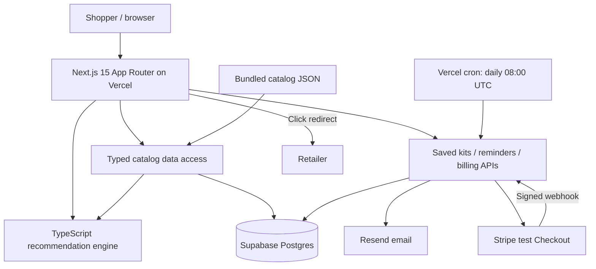

# GearFit

**A workwear buying guide that matches your trade to boots and PPE, with the estimated cost per month of wear.**

**Live product:** [palantirbuisness.vercel.app](https://palantirbuisness.vercel.app) · Business Cup 2.0, Money track · Team Palantir

## Problem and target user

US tradespeople aged **25–45 who buy their own boots and PPE** must balance jobsite requirements, fit and a personal budget. A cheap pair of boots can cost more over a year if it wears out faster; comparing safety labels across a whole kit adds work.

GearFit turns those decisions into one kit with documented standards, approximate prices, replacement estimates and a reason for every pick. The catalog contains **153 real product entries** across nine categories, including women's models. Recommendations are calculated from catalog data and questionnaire answers.

## How it works

1. Answer five steps: trade; hazards; climate and hours/week; employer requirements; sizes and budget.
2. The deterministic engine filters by required protection and standards for one of 11 trades, then ranks eligible products by price, lifetime cost and quality. Hours/week scale lifespan; product ID breaks ties. An unmet safety requirement produces a warning.
3. Compare the full kit and alternatives side by side, swap products, and follow a retailer link to check the current price. Each option lists pros and cons computed from catalog data only (price, estimated wear life, cost per month, quality score, rated levels against the requirement, features, sizing), ranked among the options shown; a metric where every option ties produces no line. Optional affiliate tags are added on the server.
4. Save on the device or create a public `/k/<slug>` link. Cloud saves rebuild the kit on the server, preserving eligible swaps while ignoring client prices and safety claims.
5. Download calendar replacement dates or opt into email reminders. Confirmed reminders become due seven days before estimated replacement. Pro uses **Stripe test mode**, at $4/month, with subscription status verified on the server.

Prices are approximate and include `last_checked`; lifespans are planning estimates, not manufacturer replacement intervals. GearFit does not replace a workplace hazard assessment. Missing-category warnings mean a kit is incomplete. See [catalog evidence and safety boundaries](docs/catalog-sources.md).

## Architecture



- **Frontend:** Next.js 15, React 19, TypeScript, Tailwind CSS 4. `src/lib/server/kit-view.ts` supplies server-rendered kits and catalog views using the same 60-second catalog cache as click redirects, with snapshot fallback and size relaxation when needed. Safety filters stay mandatory. Entrances and count-ups are CSS and small helpers in `src/components/fx.tsx`; Motion (lazy bundle, `src/components/motion.tsx`) handles exits and height changes on `/build` and `/kit` only. All motion respects `prefers-reduced-motion`. Product visuals are in-house SVG illustrations of the gear type (`src/components/GearArt.tsx`), not retailer photos; details such as a safety-toe cap or a tinted lens follow catalog fields. Pros and cons come from `src/lib/pros-cons.ts`.
- **Engine and data:** `src/lib/engine.ts`, `src/data/catalog.json` and Zod schemas. The catalog APIs use the snapshot when database credentials are absent; a configured but unavailable/empty catalog returns 503. Landing-page reference facts use the snapshot.
- **Persistence:** Supabase stores products, clicks, saved kit snapshots, consent, reminder deliveries, rate limits and test subscriptions. RLS/service-role access keeps direct table access server-side.
- **Retention:** Resend handles double opt-in and reminders. Vercel cron processes due deliveries; Stripe Checkout status and signed webhooks persist subscription state.

## API

JSON errors use `{ "error": "..." }`. Inputs are validated with Zod. Public kit links require no account; anyone with a slug can view the kit.

| Method and path | Purpose / response |
| --- | --- |
| `GET /api/catalog?category=boots` | `{ count, products, trades, hazards }`; category optional |
| `POST /api/recommend` | Questionnaire answers → `{ token, kit }` |
| `GET /api/click?productId=...&kitId=...` | Retailer redirect, HTTP 302; `kitId` optional |
| `POST /api/click` | `{ productId, kitId? }` → `{ redirectUrl, tracked }` |
| `POST /api/kits` | `{ answers, choices?, ...displayFields }` → 201 `{ slug, createdAt }`; display fields ignored |
| `GET /api/kits/[slug]` | `{ slug, answers, items, createdAt }`; unknown slug → 404 |
| `POST /api/reminders` | `{ email, kitSlug }` → `{ status: "pending" \| "confirmed" }` |
| `GET /api/reminders/confirm?token=...` | Confirmation form; POST confirms and redirects to `/reminders` |
| `GET /api/reminders/unsubscribe?token=...` | Unsubscribe and redirect; POST supports one-click JSON response |
| `GET /api/cron/reminders` | Bearer `CRON_SECRET`; sends due reminders and opted-in deals |
| `POST /api/cron/reminders` | Same auth plus `REMINDER_TEST_MODE=true`; `{ kitSlug }` demonstrates reminders, `{ kitSlug, deals: true }` demonstrates real price drops |
| `POST /api/subscribe` | `{ email }` → `{ url, accessToken, testMode }` |
| `GET /api/subscribe?session_id=...` | Verifies Checkout → `{ active, email }` |
| `POST /api/stripe/webhook` | Signed Stripe event → `{ received: true }` |
| `GET /api/stats` | SQL counts for kits, clicks, consent and test subscriptions |
| `GET /api/pro` | Bearer checkout `accessToken` → `{ pro, features }` |
| `GET/POST /api/pro/wear` | Bearer capability; read or record hours worn |
| `GET/POST /api/pro/deals` | Bearer capability; read catalog comparisons or toggle alerts |

Click destinations use a catalog cached for 60 seconds, with the bundled snapshot as fallback when the read fails. For a known product, GET returns 302 before recording the click with Next.js `after()`; an insert failure cannot change the redirect. POST returns `{ redirectUrl, tracked: false }` when storage is missing or an insert fails. GET ignores unrelated query parameters such as `utm_*` and `fbclid`; duplicate `productId` or `kitId` values still return 400, and unknown products remain 404. Recommendation/catalog APIs retain their documented 503 behavior for configured database failures.

Free kits are limited to three per device; the cloud-save abuse limit is 200/hour/IP. Wear tracking remains local; the current UI does not call `/api/pro/wear`. See the [frontend contract](docs/api-contract.md) and [full backend examples](docs/backend-handoff.md#retention-api-examples).

## Pro deal alerts

Checkout saves its secret `accessToken` on the current device before redirecting to Stripe. After confirmation, `GET /api/pro` verifies server access using the Authorization header. Tokens never go in share links or logs; use the same device/browser to manage alerts.

On a cloud-saved kit, turn on **Deal alerts** next to replacement reminders. Alerts require active server-side Pro and a confirmed reminder for the **same Pro email and kit**. The switch restores its server setting and explains missing consent, pending Pro activation or temporary failures. Free users get a link to Pro.

Daily cron compares saved prices with a fresh, uncached Supabase catalog read; a failed read falls back to the bundled snapshot. Only a lower recorded price qualifies. These are catalog estimates, not live retailer sale guarantees. The authenticated deal demo uses fresh delivery identities in the existing table, so rehearsals do not consume real delivery deduplication. **No new migration is needed.** See the [demo steps](docs/backend-handoff.md#60-second-production-demo).

## Local setup

Use **Node.js 24** (`.nvmrc`; minimum 22.12) and npm.

```bash
npm ci
cp .env.example .env.local
npm run dev
# Open http://localhost:3000
```

PowerShell: use `Copy-Item .env.example .env.local` instead of `cp`. Leave database settings blank for the bundled catalog. Builds and tests require no provider credentials; cloud saves, email and billing need the services below. `.env.local` is ignored by Git. Never prefix server secrets with `NEXT_PUBLIC_`.

### Supabase and Vercel

1. In Supabase SQL Editor, apply `supabase/migrations/202611140001_catalog.sql`, then `202611140002_clicks.sql` once.
2. Set the Supabase URL and server key in `.env.local`. Run `npm run catalog:check`, then `npm run seed`. The seed upserts by product ID without deleting other products or clicks.
3. Paste `supabase/retention-setup.sql` and run it **once**. Alternatively apply the four `20261114100001`–`20261114100004` migrations in order; do not apply both methods or replay an existing schema.
4. Import the repo into Vercel, select Node.js 24, configure variables for the intended environments and redeploy. `vercel.json` supplies Next.js build settings and the daily cron.
5. Configure a Stripe **test** webhook at `<APP_URL>/api/stripe/webhook` for `checkout.session.completed`, `customer.subscription.created`, `customer.subscription.updated` and `customer.subscription.deleted`.
6. Configure Resend. Its onboarding sender only delivers to the account owner's inbox; other recipients require a verified sending domain.
7. Run `npm run smoke`, then the [saved-kit, reminder and checkout demo](docs/backend-handoff.md#60-second-production-demo).

The smoke script checks public routes only. Live email delivery, Checkout and webhook processing need the separate demo. See the [deployment guide](docs/backend-handoff.md) for operational details.

## Environment variables

Copy the documented defaults from [.env.example](.env.example). Vercel injects the `VERCEL*` values.

| Variable | Purpose / default |
| --- | --- |
| `SUPABASE_URL` | Project API URL; pair with a server key to enable persistence |
| `SUPABASE_SECRET_KEY` | Preferred Supabase server key (`sb_secret_...`) |
| `SUPABASE_SERVICE_ROLE_KEY` | Legacy fallback, used only when the preferred key is blank |
| `AFFILIATE_TAG` | Optional partner tag; blank leaves links untagged |
| `AFFILIATE_PARAM` | Partner query parameter; defaults to `tag` |
| `APP_URL` | Canonical origin for email/checkout, e.g. `https://palantirbuisness.vercel.app`; local HTTP supported |
| `VERCEL_PROJECT_PRODUCTION_URL` | Injected production hostname; HTTPS fallback when `APP_URL` is blank |
| `RATE_LIMIT_SECRET` | Recommended random 32+ byte HMAC secret; absent → unsalted SHA-256 buckets |
| `CRON_SECRET` | Required independent bearer secret for cron and demo sends |
| `RESEND_API_KEY` | Server email API key |
| `RESEND_FROM` | Verified sender, e.g. `GearFit <reminders@example.com>` |
| `REMINDER_TEST_MODE` | `true` enables authenticated immediate demo sends; default `false` |
| `STRIPE_SECRET_KEY` | Test key (`sk_test_...`); live keys rejected |
| `STRIPE_WEBHOOK_SECRET` | Signing secret (`whsec_...`) for the deployed webhook |
| `NEXT_PUBLIC_API_MOCKS` | Keep `0`/unset in production; `1` enables local frontend mocks |
| `NEXT_PUBLIC_SITE_URL` | Optional canonical origin for frontend metadata/share previews |
| `VERCEL_URL` | Injected deployment hostname; final frontend metadata fallback |
| `VERCEL` | Injected `1` selects Vercel's trusted forwarded-IP header for rate limits |

An affiliate tag requires a matching retailer partnership to earn commission. Raw IPs are not stored; without `RATE_LIMIT_SECRET`, bucket hashes offer weaker privacy against guessed addresses.

## Tests and review

```bash
npm run lint
npx tsc --noEmit
npm test
npm run build
npm run catalog:check
npm run smoke
# Optional target: npm run smoke -- http://localhost:3000
```

GitHub Actions runs lint, TypeScript, tests and the production build on every push and pull request. Tests use Vitest, mocked provider calls and PGlite for actual Postgres migrations/RPCs; no Docker or live secrets are needed.

Coverage includes all 11 trades, mandatory standards, deterministic picks, workload scaling, tiny budgets, women's sizes, empty extra hazards, API validation, saved swaps, reminder timing/consent, repeatable demos, Stripe binding and stats. `npm run catalog:check` validates the full snapshot without contacting Supabase.

`scripts/smoke.mjs` defaults to the live URL and checks `/`, `/api/catalog`, an electrician recommendation and the click's 302 destination. It prints PASS/FAIL and exits nonzero if any check fails. **It creates one click event when tracking is available**, does not follow the retailer redirect, and does not create kits, emails or payments.

For code review, start with `src/lib/engine.ts`, `src/lib/server/`, `src/lib/retention/`, `supabase/migrations/` and `tests/`. Product evidence is in [docs/catalog-sources.md](docs/catalog-sources.md).

## Team

**Palantir — Business Cup 2.0, Money track.** Work is split across product/frontend, catalog and recommendation backend, and retention/payments backend. See [repository contributors](https://github.com/baurvtm-stack/BUISNESSCUP_PALANTIR/graphs/contributors) and pull requests for individual contributions.
